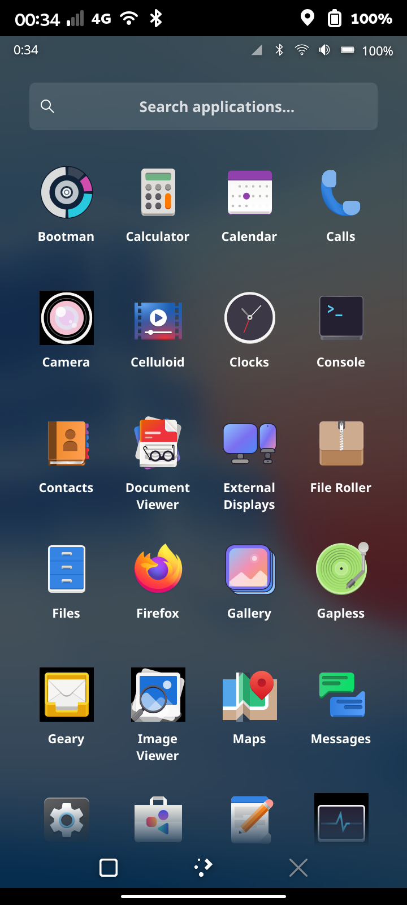
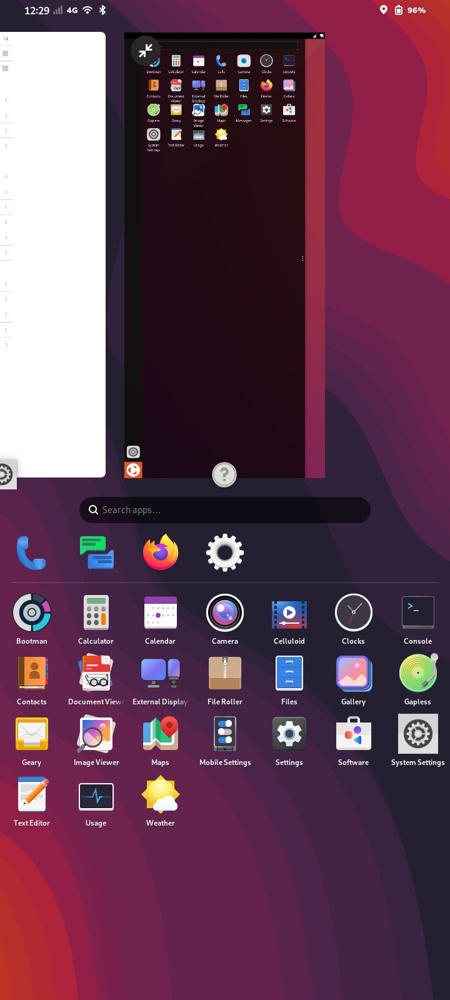
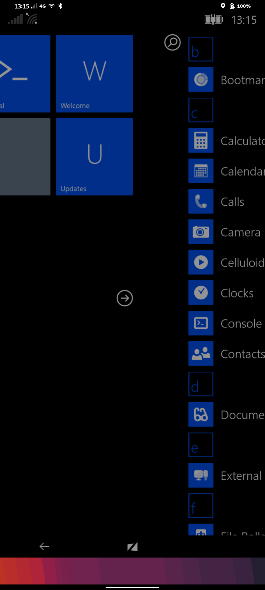
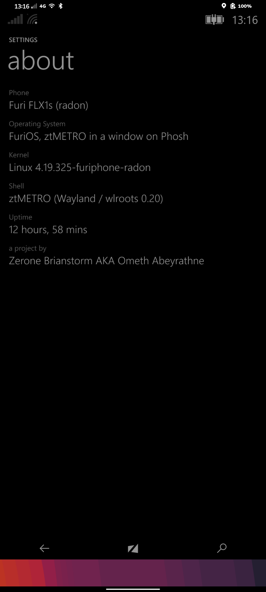

# Nested shells for FuriOS

Try Plasma Mobile, Lomiri or ztOS's ztMETRO shell in a window on Phosh, on a Furi FLX1s. Your Phosh session keeps running underneath.

These are demos. Everything draws on the CPU, so they're slow and use a lot of battery.

| Plasma Mobile | Lomiri | ztMETRO | ztMETRO settings |
|---|---|---|---|
|  |  |  |  |

## Before you start

- **FLX1s only.** The installer stops on anything else, including the FLX1.
- **Use a spare Bootman install.** The packages are large and hard to remove completely.
- **Don't rely on the phone for calls during a test.** Lomiri starts its own telephony services, and how they affect calls is untested.

## Install

Read `install.sh` first, since it uses `sudo`.

```
git clone <repo URL>
cd <repo>
./install.sh                # asks which shells you want
./install.sh --dry-run      # shows what would be added, changes nothing
./install.sh lomiri plasma  # or name them
```

| Shell | How it's installed | Adds |
|---|---|---|
| Plasma Mobile | apt | About 350 packages, about 1 GB |
| Lomiri | apt | About 170 packages |
| ztMETRO, experimental | Built on the phone from upstream source plus the patches here | About 150 build packages, several minutes |

Package counts depend on what's already installed.

## Use

Look for "(window)" in the app list.

- Tap an icon to open that shell. Tap it again to close it.
- Opening a shell closes any other.
- Each closes by itself after 30 minutes.
- Lomiri and ztMETRO make Phosh look tiny while they run, because touch only lines up at display scale 1. Phosh returns to normal size afterwards.

## Known limits

- **ztMETRO:** cellular doesn't work, because it depends on ztOS's own `ztoscorenetworkingd`. There are no wallpapers, and some tiles won't open.
- **Lomiri:** pinned launcher apps may not open, and sharing between apps isn't available. On first start you'll see its setup wizard.
- **Plasma Mobile:** it draws through Mesa's lavapipe, which keeps several CPU cores busy.

## Uninstall

```
./uninstall.sh
```

This removes the launchers and the ztMETRO build, then shows the packages it added and asks before removing them. If that would also remove anything else, it leaves all the packages in place.

## How it works

- **Plasma Mobile:** KWin runs nested on phoc, and Qt draws through lavapipe using the real Vulkan loader instead of libhybris's.
- **Lomiri:** Mir runs nested on phoc through its Wayland backend, using Mesa's EGL.
- **ztMETRO:** phoc offers no DMA-BUF and the phone has no DRM render node, so wlroots can't create its GLES2 renderer. A private copy of wlroots 0.20.2 is patched to render offscreen, and ztMETRO is patched to copy each frame into shared memory. The system's wlroots isn't touched.

## Credits and licence

- ztMETRO is from [ztOS](https://github.com/Zerone-Laboratories/ztOS), by Zerone Laboratories. It's fetched at a pinned commit and patched during install.
- [wlroots](https://gitlab.freedesktop.org/wlroots/wlroots), [Plasma Mobile](https://plasma-mobile.org) and [Lomiri](https://lomiri.com) belong to their own projects.
- This project has no connection to any of them, or to FuriLabs.

The scripts here are GPL-3.0-or-later. The patches are under the licences of the code they change.
